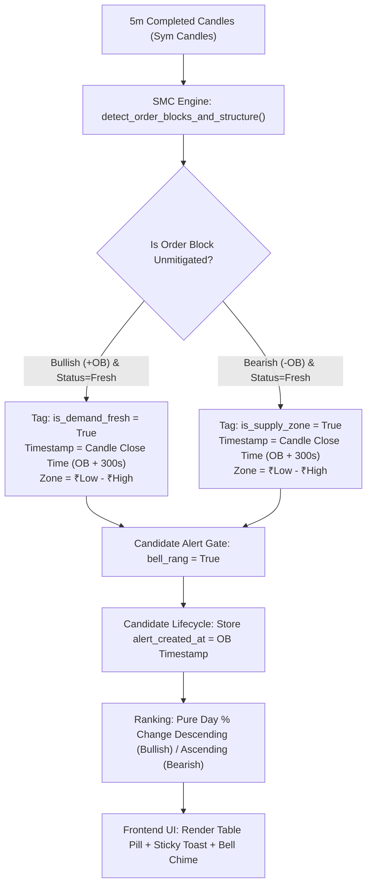

# Implementation Guide: SMC Demand Fresh & Bear OB Fresh Engine

> **Target Goal**: Implement Smart Money Concept (SMC) **Demand Fresh** (for Bullish candidates) and **Bear OB Fresh** (for Bearish candidates) into the stock suggestion scanner and dashboard, ensuring high-accuracy institutional entry zones without artificial time-decay penalties.

---

## 1. Architectural Overview & Design Principles



### Core Rules & Guardrails
1. **Never Add Artificial Age Decay**: Do **not** disqualify an order block because 25 minutes have elapsed (`age <= 25m`). Real institutional demand bases remain valid until mitigated (broken through) by price.
2. **Preserve Percentage Ranking**: Keep leaderboard ranking sorted strictly by percentage change (highest % at Top 1 for Bullish, largest % drop at Top 1 for Bearish). Never let an order block tag demote the true session momentum leader.
3. **Accurate Timestamping**: The displayed time must be the **exact 5m candle close timestamp** when the order block completed (`ob_time + 300s`), formatted in IST (e.g., `09:35 AM`, `02:00 PM`), never `None` or generic scanner scan times.
4. **Noise-Free Audio Alerting**: The bell chime and toast alert should ring **strictly** when `is_demand_fresh` (Bullish) or `is_supply_zone` (Bearish) is present. Generic breakouts without an unmitigated base should not ring the bell.

---

## 2. Step 1: Data Model Updates

In `stock_suggestion_index.py`, add the SMC fields to the candidate `Suggestion` dataclass:

```python
@dataclass
class Suggestion:
    # Existing fields: symbol, side, ltp, percent_change, rank, etc.
    # ...
    
    # ── SMC Demand / Supply Order Block Fields ──
    is_demand_fresh: bool = False
    demand_zone: str = ""
    demand_fresh_time: str | None = None
    
    is_supply_zone: bool = False
    supply_zone: str = ""
    supply_zone_time: str | None = None
```

In `Suggestion.to_dict()`:
```python
def to_dict(self) -> dict[str, Any]:
    return {
        # ... existing serialized fields ...
        "is_demand_fresh": self.is_demand_fresh,
        "demand_zone": self.demand_zone,
        "demand_fresh_time": self.demand_fresh_time,
        "is_supply_zone": self.is_supply_zone,
        "supply_zone": self.supply_zone,
        "supply_zone_time": self.supply_zone_time,
    }
```

---

## 3. Step 2: SMC Detection Logic in `build_suggestions()`

Inside `build_suggestions(rows, raw_by_symbol, side, top, index_context, candles_by_symbol)`:

```python
from datetime import datetime
from zoneinfo import ZoneInfo
INDIA_TZ = ZoneInfo("Asia/Kolkata")

# For each candidate symbol:
is_demand_fresh = False
demand_zone_str = ""
demand_fresh_time = None

is_supply_zone = False
supply_zone_str = ""
supply_zone_time = None

try:
    from smc_volume_profile_engine import detect_order_blocks_and_structure
    ob_res = detect_order_blocks_and_structure(sym_candles)
    obs = ob_res.get("order_blocks", [])
    live_ltp_ob = float(row.get("ltp") or (sym_candles[-1]["close"] if sym_candles else 0.0))
    latest_bar_ts = sym_candles[-1]["timestamp"] if sym_candles else 0

    if side == "bullish":
        # 1. Filter for unmitigated Bullish Order Blocks (+OB)
        bull_obs = [ob for ob in obs if ob.get("type") == "BULLISH" and not ob.get("mitigated")]
        # Prioritize genuinely Fresh demand bases first, then latest by time
        bull_obs.sort(key=lambda x: (1 if x.get("status") == "Fresh" else 0, x.get("time", 0)), reverse=True)
        
        for ob in bull_obs:
            top_b = ob.get("top", 0.0)
            bot_b = ob.get("bottom", 0.0)
            # Price must be respecting or trading above the demand zone
            if live_ltp_ob >= bot_b * 0.995:
                is_demand_fresh = True
                st_label = ob.get("status", "Fresh")
                demand_zone_str = f"₹{bot_b:.1f}-₹{top_b:.1f} ({st_label})"
                ob_t = ob.get("time") or latest_bar_ts
                # 5-minute candle completion timestamp: add 300 seconds
                demand_fresh_time = datetime.fromtimestamp(ob_t + 300, tz=INDIA_TZ).strftime("%I:%M %p")
                break
    else:
        # 2. Filter for unmitigated Bearish Order Blocks (-OB / Supply Zone)
        bear_obs = [ob for ob in obs if ob.get("type") == "BEARISH" and not ob.get("mitigated")]
        bear_obs.sort(key=lambda x: (1 if x.get("status") == "Fresh" else 0, x.get("time", 0)), reverse=True)
        
        for ob in bear_obs:
            top_b = ob.get("top", 0.0)
            bot_b = ob.get("bottom", 0.0)
            # Price must be respecting or trading below the supply zone
            if live_ltp_ob <= top_b * 1.005:
                is_supply_zone = True
                st_label = ob.get("status", "Fresh")
                supply_zone_str = f"₹{bot_b:.1f}-₹{top_b:.1f} ({st_label})"
                ob_t = ob.get("time") or latest_bar_ts
                supply_zone_time = datetime.fromtimestamp(ob_t + 300, tz=INDIA_TZ).strftime("%I:%M %p")
                break
except Exception as e:
    # Safe fallback if candles or SMC engine is unavailable
    pass
```

### Tag Generation for Quality Tags
Add human-readable tags into `quality_tags` so downstream clients and overview drawers can display the zone:
```python
if is_demand_fresh and demand_fresh_time:
    quality_tags.append(f"🟢 DEMAND · FRESH ({demand_zone_str}) [{demand_fresh_time}]")
elif is_supply_zone and supply_zone_time:
    quality_tags.append(f"🔴 BEAR OB · FRESH ({supply_zone_str}) [{supply_zone_time}]")
```

---

## 4. Step 3: Precision Bell Alerting & Candidate Lifecycle

### Bell Trigger Condition
Only candidates with confirmed SMC Order Blocks ring the alert bell:
```python
if side == "bullish":
    is_demand_trigger = is_demand_fresh and bool(demand_fresh_time)
    bell_rang = bool(is_demand_trigger and (is_breakout or chart_structure != "Consolidating"))
else:
    is_supply_trigger = is_supply_zone and bool(supply_zone_time)
    bell_rang = bool(is_supply_trigger and (is_breakout or chart_structure != "Consolidating"))
```

### Candidate Lifecycle Timestamping
In `_process_candidate_lifecycle()`:
Ensure that `alert_created_at` records the **Order Block candle time** rather than the arbitrary server polling clock:
```python
current_ob_time = item.demand_fresh_time if side == "bullish" else item.supply_zone_time
last_ob_time = entry.get("last_ob_alert_time")
is_new_ob_time = bool(current_ob_time and current_ob_time != last_ob_time)

if item.bell_rang and (not entry.get("alert_fired") or is_new_ob_time):
    entry["first_alerted_at"] = entry.get("first_alerted_at") or market_clock_ist
    entry["last_ob_alert_time"] = current_ob_time
    entry["alert_fired"] = True
    entry["alert_count"] = (entry.get("alert_count", 0) + 1) if entry.get("alert_fired") else 1
    # STRICT REQUIREMENT: alert_created_at must carry the accurate base formation time!
    entry["alert_created_at"] = current_ob_time or market_clock_ist
```

---

## 5. Step 4: Clean Percentage Ranking

Do **not** apply complex multi-tier penalties that sort older bases lower. Sort strictly by percentage move so leaders stay fixed at the top of the table:

```python
if side == "bullish":
    suggestions.sort(key=lambda item: item.percent_change if item.percent_change is not None else -9999, reverse=True)
else:
    suggestions.sort(key=lambda item: item.percent_change if item.percent_change is not None else 9999)

for idx, item in enumerate(suggestions, start=1):
    item.rank = idx
```

---

## 6. Step 5: Frontend UI Implementation (`MLAIStockV2.html`)

### A. Detail Table Column `5 MIN BO/BD` (`renderTable`)
In `renderTable(rows)`:
```javascript
const qTags = row.quality_tags || [];
const isDemand = Boolean(row.is_demand_fresh || qTags.some(t => t.includes("DEMAND · FRESH")));
const isSupply = Boolean(row.is_supply_zone || qTags.some(t => t.includes("BEAR OB · FRESH") || t.includes("SUPPLY ZONE")));

const eventTime = isDemand 
  ? (row.demand_fresh_time || row.breakout_time) 
  : (isSupply ? (row.supply_zone_time || row.breakout_time) : row.breakout_time);
const timeStr = eventTime ? ` ${eventTime}` : "";

let statusBadge = "";
let boCls = "wait";

if (isDemand && !isBreakdown) {
  statusBadge = `🟢 DEMAND · FRESH${timeStr}`;
  boCls = "bo";
} else if (isSupply && isBreakdown) {
  statusBadge = `🔴 BEAR OB · FRESH${timeStr}`;
  boCls = "bd";
} else if (isCascade) {
  statusBadge = isBreakdown ? `⚡ WATERFALL${timeStr}` : `⚡ IMPULSE${timeStr}`;
  boCls = isBreakdown ? "waterfall" : "impulse";
} else if (isBreakout || isBreakdown) {
  statusBadge = isBreakdown ? `🔴 BREAKDOWN${timeStr}` : `🟢 BREAKOUT${timeStr}`;
  boCls = isBreakdown ? "bd" : "bo";
} else {
  statusBadge = `${row.five_min_status || "Consolidating"}${timeStr}`;
  boCls = "wait";
}
```

### B. Sticky Toast Notification (`showStickyToast`)
Render clean banners with exact timestamps when an alert fires:
```javascript
const qTags = item.quality_tags || [];
const isDemand = Boolean(item.is_demand_fresh || qTags.some(t => t.includes("DEMAND · FRESH")));
const isSupply = Boolean(item.is_supply_zone || qTags.some(t => t.includes("BEAR OB · FRESH") || t.includes("SUPPLY ZONE")));

const timeDisplay = isDemand ? item.demand_fresh_time : (isSupply ? item.supply_zone_time : item.breakout_time);

let statusText = "";
let bannerText = "";

if (isDemand && !isPE) {
  const dZone = item.demand_zone ? ` [${item.demand_zone}]` : "";
  statusText = `🟢 DEMAND · FRESH ${timeDisplay}${dZone}`;
  bannerText = `<div style="font-size:10px; font-weight:800; color:#047857; background:#d1fae5; border:1px solid #6ee7b7; border-radius:4px; padding:2px 5px; margin:2px 0; display:inline-block;">🛡️ DEMAND FRESH BASE DEFENDED · LOW-RISK SWEET SPOT</div>`;
} else if (isSupply && isPE) {
  const sZone = item.supply_zone ? ` [${item.supply_zone}]` : "";
  statusText = `🔴 BEAR OB · FRESH ${timeDisplay}${sZone}`;
  bannerText = `<div style="font-size:10px; font-weight:800; color:#b91c1c; background:#fee2e2; border:1px solid #fca5a5; border-radius:4px; padding:2px 5px; margin:2px 0; display:inline-block;">⚡ INSTITUTIONAL BEAR OB REJECTION · SHORT ENTRY</div>`;
}
```

### C. Bell Audio Check (`checkAndTriggerBellAlerts`)
Ensure that the client-side bell check only triggers for verified Demand Fresh or Bear OB Fresh setups:
```javascript
function checkAndTriggerBellAlerts(payload) {
  if (!payload || !payload.ok) return;
  const allRows = [...(payload.bullish || []), ...(payload.bearish || [])];

  allRows.forEach(row => {
    const isBreakdown = (row.side === "bearish") || (row.percent_change < 0);
    const qTags = row.quality_tags || [];
    const isDemandFresh = Boolean((row.is_demand_fresh || qTags.some(t => t.includes("DEMAND · FRESH"))) && !isBreakdown);
    const isSupplyZone = Boolean((row.is_supply_zone || qTags.some(t => t.includes("BEAR OB · FRESH"))) && isBreakdown);

    if (!isDemandFresh && !isSupplyZone) return;

    const eventTime = isDemandFresh ? row.demand_fresh_time : row.supply_zone_time;
    if (!eventTime) return; // Exact timestamp required

    const sideKey = isBreakdown ? "bearish" : "bullish";
    const alertKey = `${row.symbol}_${sideKey}_${eventTime}`;
    if (_alertedBreakouts.has(alertKey)) return;

    _alertedBreakouts.add(alertKey);
    if (_bellSoundEnabled) playBellRangSound();
    showStickyToast(row, isBreakdown);
  });
}
```

---

## 7. Step 6: Automated Verification & Unit Test Suite

Create `test_demand_fresh_alerts.py` to test all conditions automatically:

```python
import unittest
import tempfile
from pathlib import Path
from unittest.mock import patch
from datetime import datetime
from zoneinfo import ZoneInfo
import stock_suggestion_index as ssi
from stock_suggestion_index import build_suggestions, enforce_candidate_lifecycle_and_mutual_exclusion

INDIA_TZ = ZoneInfo("Asia/Kolkata")

class TestDemandFreshAndBearOBAlerts(unittest.TestCase):
    def setUp(self):
        self.temp_dir = tempfile.TemporaryDirectory()
        self.lifecycle_path = Path(self.temp_dir.name) / "candidate_lifecycle.json"
        self.patcher = patch.object(ssi, "CANDIDATE_LIFECYCLE_PATH", self.lifecycle_path)
        self.patcher.start()

    def tearDown(self):
        self.patcher.stop()
        self.temp_dir.cleanup()

    def test_bullish_demand_fresh_triggers_bell(self):
        """Bullish stock with DEMAND FRESH and valid timestamp must set bell_rang=True."""
        t0 = int(datetime(2026, 11, 11, 9, 15, tzinfo=INDIA_TZ).timestamp())
        candles = [
            {"timestamp": t0, "open": 100.0, "high": 102.0, "low": 99.0, "close": 101.0, "volume": 10000},
            {"timestamp": t0 + 300, "open": 101.0, "high": 103.0, "low": 100.0, "close": 102.5, "volume": 12000},
            {"timestamp": t0 + 600, "open": 102.5, "high": 103.0, "low": 98.0, "close": 98.5, "volume": 15000},
            {"timestamp": t0 + 900, "open": 98.5, "high": 99.0, "low": 97.5, "close": 98.0, "volume": 20000}, # swing low / demand OB
            {"timestamp": t0 + 1200, "open": 98.0, "high": 101.0, "low": 98.0, "close": 100.5, "volume": 50000},
            {"timestamp": t0 + 1500, "open": 100.5, "high": 104.0, "low": 100.0, "close": 103.8, "volume": 80000}, # BOS breakout
        ]
        row = {"symbol": "DEMAND_TEST", "ltp": 103.8, "percent_change": 3.5, "high": 104.0, "low": 97.5, "volume": 200000}
        res, _ = build_suggestions([row], {"DEMAND_TEST": row}, side="bullish", top=5, index_context={}, candles_by_symbol={"DEMAND_TEST": candles})
        
        self.assertEqual(len(res), 1)
        item = res[0]
        self.assertTrue(item.is_demand_fresh)
        self.assertEqual(item.demand_fresh_time, "09:35 AM")
        self.assertTrue(item.bell_rang)

    def test_bullish_without_demand_fresh_suppresses_bell(self):
        """Generic breakouts without Demand Fresh must NEVER ring the bell."""
        t0 = int(datetime(2026, 11, 11, 9, 15, tzinfo=INDIA_TZ).timestamp())
        candles = [{"timestamp": t0 + (i * 300), "open": 100.0 + i, "high": 101.0 + i, "low": 99.8 + i, "close": 100.8 + i, "volume": 10000} for i in range(8)]
        row = {"symbol": "GENERIC_BO", "ltp": 108.0, "percent_change": 4.5, "high": 108.0, "low": 99.8, "volume": 200000}
        res, _ = build_suggestions([row], {"GENERIC_BO": row}, side="bullish", top=5, index_context={}, candles_by_symbol={"GENERIC_BO": candles})
        
        self.assertEqual(len(res), 1)
        self.assertFalse(res[0].is_demand_fresh)
        self.assertFalse(res[0].bell_rang)

if __name__ == "__main__":
    unittest.main()
```

---

## 8. Summary Checklist Before Merging

- [ ] Data models include `is_demand_fresh`, `demand_zone`, `demand_fresh_time` (and bearish counterparts).
- [ ] Timestamps calculate exact 5m candle close (`ob_time + 300s`) formatted in IST (`%I:%M %p`).
- [ ] No artificial time-decay or 25-minute disqualification (`age <= 25m`) anywhere in the code.
- [ ] Leaderboard ranks strictly by percentage change (highest % at Rank 1).
- [ ] Detail table displays `🟢 DEMAND · FRESH [time]` and `🔴 BEAR OB · FRESH [time]`.
- [ ] Sticky toast displays accurate timestamp and zone bounds.
- [ ] All unit tests pass cleanly (`Ran 5 tests ... OK`).
